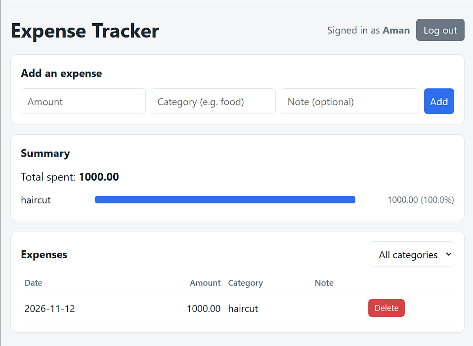

# Expense Tracker (Python + Flask + JWT)



A multi-user web app for recording daily expenses, filtering them by category, and viewing a spending summary. Users register and log in with **JWT authentication**, and each user only sees their own expenses. It started as a command-line tool and was extended with a Flask web interface and a small JSON API that reuse the same core logic. Data is saved locally in JSON files.

## Features

- Register and log in; passwords are stored as salted hashes, never as plain text
- **JWT authentication:** signed tokens with an expiry time
  - Web pages: token kept in an `HttpOnly`, `SameSite=Lax` cookie
  - JSON API: token sent in an `Authorization: Bearer <token>` header
- Per-user data: users cannot see or delete each other's expenses
- Add expenses with an amount, category, and optional note
- Filter the list by category, and see a summary with a percentage bar per category
- Delete expenses (with a confirmation prompt)
- Input validation with clear error messages
- Responsive layout that works on phones
- Templates auto-escape user input to prevent XSS
- Command-line version still available (`tracker.py`)
- 49 automated tests with `pytest`

## How the login works

1. The user submits a username and password.
2. The server checks the password against the stored hash.
3. If it matches, the server creates a JWT containing the username (`sub`) and an expiry time (`exp`), signed with a secret key (HS256).
4. The browser sends the token back on every request. The server checks the signature and expiry, so it does not need to store sessions.
5. A token that is expired, tampered with, signed with another key, or unsigned (`alg: none`) is rejected.

## Project structure

```
tracker.py        Core logic + command-line interface
auth.py           Users, password hashing, JWT creation and checking, login decorators
app.py            Flask routes (web pages and JSON API)
templates/        HTML pages (Jinja2): index, login, register
static/           CSS
test_tracker.py   Tests for the core logic
test_auth.py      Tests for JWT, users, access control and the API
test_app.py       Tests for the web pages
```

## Setup

```bash
python -m venv venv
source venv/bin/activate        # Windows: venv\Scripts\activate
pip install -r requirements.txt
```

Set your own secret key for signing tokens (do this before deploying):

```bash
# Windows PowerShell
$env:JWT_SECRET = "a-long-random-string-at-least-32-characters"
# Mac / Linux
export JWT_SECRET="a-long-random-string-at-least-32-characters"
```

If `JWT_SECRET` is not set, a development-only default is used.

## Run the web app

```bash
python app.py
```

Open http://127.0.0.1:5000, register an account, and start adding expenses.

## Use the JSON API

```bash
# 1. Log in to get a token
curl -X POST http://127.0.0.1:5000/api/login \
  -H "Content-Type: application/json" \
  -d '{"username": "sahil", "password": "password123"}'

# 2. Use the token
curl http://127.0.0.1:5000/api/expenses -H "Authorization: Bearer <token>"

curl -X POST http://127.0.0.1:5000/api/expenses \
  -H "Authorization: Bearer <token>" -H "Content-Type: application/json" \
  -d '{"amount": 250, "category": "food", "note": "Lunch"}'

curl -X DELETE http://127.0.0.1:5000/api/expenses/1 -H "Authorization: Bearer <token>"
```

| Method | Endpoint             | Needs token | Purpose                     |
| ------ | -------------------- | ----------- | --------------------------- |
| POST   | `/api/login`         | No          | Get a token                 |
| GET    | `/api/expenses`      | Yes         | List your expenses          |
| POST   | `/api/expenses`      | Yes         | Add an expense              |
| DELETE | `/api/expenses/<id>` | Yes         | Delete one of your expenses |

## Run the command-line version

```bash
python tracker.py add 250 food "Lunch"
python tracker.py list
python tracker.py summary
```

## Run the tests

```bash
pytest
```

## Security notes

- Passwords are hashed with Werkzeug (salted, slow hashing); usernames and passwords are validated.
- The token cookie is `HttpOnly` (page scripts cannot read it) and `SameSite=Lax` (not sent on cross-site POSTs). Set `COOKIE_SECURE=1` when serving over HTTPS.
- API routes accept only the `Authorization` header and ignore the cookie, so another website cannot make a logged-in browser call them.
- Tokens expire after 60 minutes. The signing algorithm is fixed on the server and never taken from the token.
- Users and expenses are checked by owner on every read and delete.

## What I learned

- How JWTs work: claims, signing, expiry, and why the server must pin the algorithm
- Password hashing and safe login handling
- Cookie-based vs header-based authentication, and the security trade-offs of each
- Protecting routes with decorators
- Testing authentication, including forged, expired and unsigned tokens
- Keeping data private between users

## Ideas for future improvements

- Replace the JSON files with SQLite or Postgres
- Refresh tokens and a token blacklist for logout
- Login rate limiting
- CSV export, monthly budgets, charts
- Deploy online (for example on Render)
